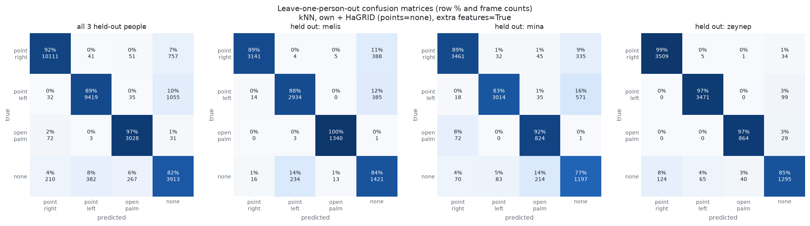

# Gesture Slide Clicker

Control presentation slides with hand gestures in front of a webcam. Point
right for the next slide, point left for the previous slide, and show an open
palm to pause or resume. Everything else (talking, touching your face, holding
a cup) should do nothing.

A one-week data science project. The focus is the ML part: our own data, our
own classifier, and an honest evaluation, given that only 3 people recorded
training data.

| Gesture | Action |
|---|---|
| `point_right` (index finger or flat hand) | next slide (right arrow) |
| `point_left` (index finger or flat hand) | previous slide (left arrow) |
| `open_palm` (palm to camera, fingers up) | pause / resume (ignore all gestures until shown again) |
| `none` | anything else: nothing happens |

## How it works

```
webcam (OpenCV, mirrored)
  -> 21 hand landmarks (MediaPipe HandLandmarker)
  -> normalized features (relative to wrist, scaled by palm length)
  -> classifier (scikit-learn kNN) -> (gesture, confidence) per frame
  -> smoothing (confidence threshold + K frames in a row + cooldown)
  -> key press (pyautogui) or Keynote command (AppleScript)
```

- **Mirroring:** the camera image is flipped once, in `landmarks.py`, so
  recording and live use see the same image. "Point right" always means the
  presenter's own right.
- **Privacy:** only landmark coordinates are stored, never images or video.
- **Interface:** `classifier.load_classifier().predict(landmarks)` returns
  `(gesture_name, confidence)`. This is the only thing `live.py` knows about the model.

## Setup (macOS, Python 3.11)

```bash
python3.11 -m venv .venv
source .venv/bin/activate
pip install -r requirements.txt
python setup_model.py        # downloads the MediaPipe hand model (7.8 MB) into models/
python src/landmarks.py      # demo: webcam with the 21 hand points drawn (q to quit)
```

Don't install `opencv-python` next to `opencv-contrib-python` (which MediaPipe
installs): both write to the same `cv2` folder and break each other.

**macOS permissions** (System Settings → Privacy & Security), for the app you run
Python from (Terminal or VS Code); restart that app afterwards:
- **Camera:** needed for everything.
- **Accessibility:** needed for real key presses. Without it, pyautogui fails
  silently and the slides don't move.
- **Automation → Keynote:** asked once when using `--keynote`.

## Usage

### 1. Record data
```bash
python src/record.py --person zeynep --gesture point_right --hand right --distance near --session 1 --note index
```
Press SPACE for a take (3 s countdown, then 15 s recording), `u` to undo the last
take, and `q` to quit and print the coverage summary. Each take is appended to
`data/gestures.csv` (tags + 63 coordinates per frame; frames without a hand are skipped).
`python src/record.py --summary` prints the coverage table at any time.

Our recording plan, per person (22 takes, about 12 minutes):
- `point_right` and `point_left`, index finger: 2 hands × 3 distances (near/mid/far)
- `point_right` and `point_left`, flat hand: 2 hands, mid distance
- `open_palm`: right hand near, left hand far
- `none`: talking / face and cup / pointing at the screen / resting

### 2. Import HaGRID (optional, public data)
```bash
mkdir -p data/hagrid_raw
curl -L -C - -o data/hagrid_raw/annotations.zip \
  https://rndml-team-cv.obs.ru-moscow-1.hc.sbercloud.ru/datasets/hagrid_v2/annotations_with_landmarks/annotations.zip
python src/import_hagrid.py   # -> data/hagrid.csv
```
The download is 719 MB of annotations only (no images). `curl -C -` resumes if
the connection drops. See [Data](#data) for what is imported and why.

### 3. Train and evaluate
```bash
python src/train.py      # ~5 min: compares models, data and features; saves models/gesture_model.joblib
python src/evaluate.py   # confusion matrix PNG + false-trigger analysis
```
Results are written to `models/results.md` and `models/evaluation.md`.

### 4. Live clicker
```bash
python src/live.py --dry-run     # prints actions, presses nothing: try this first
python src/live.py               # presses the arrow keys; click on your presentation after starting
python src/live.py --keynote     # controls Keynote directly (works without Keynote having focus)
```
Tuning: `--threshold` (min confidence per frame, default 0.8), `--frames`
(consecutive frames needed, default 15 ≈ 0.5 s), `--cooldown` (seconds after an
action, default 1.0). A gesture fires once per hold; you have to lower or change
your hand before the same gesture fires again.

### 5. Live test with new people
```bash
python src/live.py --test ayse --kind gestures --dry-run        # operator calls out gestures
python src/live.py --test ayse --kind talking --dry-run         # no gestures: count false triggers
python src/live.py --test ayse --kind presentation --keynote    # a real 5-minute talk
python src/live.py --summary                                    # results of all tests
```
The operator marks with keys on the camera window: `f` = false trigger,
`m` = missed gesture, `c` = correct (optional; unmarked actions count as
correct), `q` = finish and save. Results go to `results/live_summary.csv` and
`results/live_events.csv`.

## Data

**Own recordings:** 3 people (zeynep, mina, melis), 69 takes, 29,407 frames,
one session each, recorded the same afternoon in the same room.

| class | frames |
|---|---|
| point_right | 10,960 |
| point_left | 10,541 |
| none | 4,772 |
| open_palm | 3,134 |

Two takes had wrong tags (`--distance`). We found them by checking the hand size
in pixels (far ≈ 30 px, mid ≈ 45 px, near ≈ 90 px) and corrected them.

**HaGRIDv2** ([github.com/hukenovs/hagrid](https://github.com/hukenovs/hagrid)):
~1M photos of tens of thousands of people, with MediaPipe landmarks already
annotated. We use only the annotations, from 19,707 people:
- `palm`, `stop` → `open_palm` (20,000 hands)
- `no_gesture` + ~30 other gestures → `none` (54,000 hands)
- HaGRID's `point` is pointing *at the camera*: in 2D the index finger looks
  shorter than the other fingers, and only ~1% of those hands have just the index
  stretched out. So it is **not** our sideways point; we use it as `none`.
- **Synthetic sideways points:** upright hands rotated by ~90° (±20° jitter)
  around the wrist. `rot_one` comes from "index finger up" and gives index
  points; `rot_palm` comes from flat palms and gives flat-hand points. 20,000 each.
- Images without a person ID (7,136) are skipped, so evaluation can always
  hold out whole people.
- HaGRID gives x and y as fractions of the image size but not the size itself.
  We assume portrait 1080×1920 (the only ratio giving realistic hand
  proportions), but sizes vary, so some hands are stretched.

## Features

`features.py`, 51 values per frame:
1. Points relative to the wrist, so the position in the image doesn't matter.
2. Divided by palm length (wrist → middle knuckle), so hand size and distance don't matter.
3. **Not** rotated upright: the direction is what separates left from right.
4. Extras: how stretched out each finger is (wrist→tip / wrist→knuckle; 5 values),
   plus the direction of the index finger and of the hand (cos/sin, 4 values). The finger
   extension barely depends on HaGRID's uncertain aspect ratio.

Only x and y are used: HaGRID has no depth, and webcam depth is noisy.

## Results

All offline numbers are **leave-one-person-out** over our 3 people: train
without person P (plus HaGRID), test on P, repeat. With 3 people there are only
3 folds. The spread between folds is about ±0.06, so differences smaller than
that are not meaningful.

### Models (train: own + HaGRID palm/none)
| model | accuracy | macro F1 | point_right precision | point_left precision |
|---|---|---|---|---|
| **kNN (k=15)** | **0.90** | **0.89** | 0.97 | 0.96 |
| Random Forest | 0.85 | 0.85 | 0.98 | 0.98 |
| MLP (64, 32) | 0.84 | 0.84 | 0.97 | 0.98 |

### Training data (kNN)
| trained on | macro F1 | index points recognized | flat points recognized |
|---|---|---|---|
| own only | 0.88 | 0.96 | 0.96 |
| **own + HaGRID** (saved model) | **0.89** | 0.91 | 0.89 |
| own + HaGRID + rotated palms | 0.89 | 0.92 | 0.92 |
| HaGRID only, rotated "one" | 0.73 | 0.80 | 0.00 |
| HaGRID only, rotated palms | 0.53 | 0.09 | 0.82 |

- With our own data included, adding HaGRID changes almost nothing (within noise).
- **The synthetic data works:** trained only on rotated HaGRID hands, with zero
  recordings of our gesture, the model recognizes 80% of our index points at 0.99
  precision. Each variant only learns its own pointing style.
- Extra features: macro F1 0.89 with them, 0.87 without (within noise).

### Confusion matrix



- Left vs right is almost never confused (0–1%).
- Open palm: 97% recognized.
- Missed points fall back to `none` (7–10%): the safe direction.
- **12% of `none` frames are predicted as a point.** That's the false-trigger risk.
  It's highest while talking (18%) and while touching the face or holding a cup (14%).

### Why precision is misleading here
Point precision is ~0.97, but our test data has about twice as many pointing
frames as `none` frames. In a real talk almost every frame is `none`, so the
number that predicts false triggers is the **`none` → point rate per frame**:

| confidence threshold | none → point | points recognized |
|---|---|---|
| none | 12.4% | 90.8% |
| 0.8 (default) | 6.6% | 85.1% |
| 0.9 | 3.8% | 79.3% |

The live clicker also needs 15 frames in a row, which removes most of the remaining isolated wrong frames.

### Random split vs person split
| split | accuracy | macro F1 |
|---|---|---|
| random frames (80/20) | 0.96 | 0.95 |
| random takes (5-fold) | 0.92 | 0.89 |
| held-out person (3-fold) | 0.91 | 0.88 |

Frames of one take are nearly identical, so a random frame split puts
near-copies of training frames into the test set and overestimates accuracy.
Holding out whole takes already removes most of this. Our 3 people recorded in
the same room on the same afternoon, so the gap to truly new people and rooms is
probably larger than these 3 folds can show. That's what the live test measures.

### Live test (people not in the training data)

> **TODO: fill in after the live tests** (`python src/live.py --summary`).

| tester | test | minutes | gestures tried | recognized | false triggers | false / min |
|---|---|---|---|---|---|---|
| | gestures | | | | | |
| | talking | | | | | |
| | presentation | | | | | |

Settings: threshold 0.8, frames 15, cooldown 1.0 s (unless noted).

## Limitations

- **Only 3 people in our own training data**, one session each, same room, same
  lighting, same afternoon. Leave-one-person-out has only 3 folds, so all
  offline numbers have a large uncertainty (about ±0.06).
- The `none` class in our own data is small (4,772 frames) and covers only 4
  scripted activities; real false triggers may come from movements we didn't record.
- HaGRID landmarks are 2D, with an uncertain aspect ratio per image, and come from phone photos, not
  a laptop webcam at presentation distance.
- The synthetic pointing hands are 2D rotations of hands facing the camera; a
  real sideways point often shows the side of the hand.
- The per-frame numbers above don't include the smoothing; only the live test
  measures the real behavior.
- macOS only as written (AVFoundation camera backend, Keynote AppleScript).

## Project structure

```
setup_model.py      downloads the MediaPipe hand model
requirements.txt
src/
  landmarks.py      camera (mirrored) + MediaPipe wrapper, landmark demo
  record.py         data recording tool + coverage summary
  import_hagrid.py  HaGRID annotations -> data/hagrid.csv (incl. synthetic points)
  features.py       normalization + extra features
  classifier.py     predict(landmarks) -> (gesture, confidence)
  train.py          model / data / feature / split comparison, saves the best model
  evaluate.py       confusion matrix + false-trigger analysis
  live.py           real-time clicker (+ live test mode)
  live_test.py      live test bookkeeping
data/               gestures.csv (own), hagrid.csv (imported)
models/             hand model, trained model, results.md, evaluation.md, confusion_matrix.png
results/            live test results
```

## Credits

- Hand landmarks: [MediaPipe Hand Landmarker](https://ai.google.dev/edge/mediapipe/solutions/vision/hand_landmarker) (Google).
- Public data: *HaGRIDv2: 1M Images for Static and Dynamic Hand Gesture
  Recognition*, 2024 ([arXiv:2412.01508](https://arxiv.org/abs/2412.01508)),
  license: variant of CC BY-SA 4.0.
